# Modelo de classes — RarityRoom

Modelo textual (Mermaid) das classes de domínio em `backend/Models/`.
Atributos e métodos listados são os **relevantes** de cada classe e existem
com o mesmo nome no código C#; a seção 6 traz a tabela de correspondência
modelo ↔ código. Persistência: EF Core + SQLite (`backend/Dados/RarityRoomContexto.cs`).

Notação: `+` público, `$` estático, `-` privado. Atributos têm *setter*
privado no código (`{ get; private set; }`) — só os métodos da própria classe
os alteram.

## 1. Diagrama

```mermaid
classDiagram
    direction LR

    class Usuario {
        +int Id
        +string Nome
        +string Email
        +string SenhaHash
        +bool Ativo
        +bool Administrador
        +AlterarNome(nome)
        +AlterarEmail(email)
        +AlterarSenha(senhaHash)
        +Desativar()
        +Ativar()
        +EhProprietario(outroUsuarioId) bool
        +ValidarSenha(senha)$
    }

    class Produto {
        +int Id
        +int UsuarioId
        +string Nome
        +decimal Preco
        +int Estoque
        +string Categoria
        +EstadoAnuncio Estado
        +ModalidadeNegociacao Modalidade
        +bool Disponivel
        -Dictionary Transicoes$
        +ValidarPropriedade(solicitanteId)
        +ValidarExclusao(solicitanteId)
        +AplicarOperacao(operacao)
        +BaixarEstoque(quantidade)
        +ReporEstoque(quantidade)
        +Reabastecer(quantidade)
        +Atualizar(nome, descricao, preco, estoque, ...)
    }

    class Categoria {
        +int Id
        +string Nome
        +string Slug
        +GerarSlug(nome)$ string
    }

    class Proposta {
        +int Id
        +int ProdutoId
        +int ProponenteId
        +decimal Valor
        +EstadoProposta Estado
        +Aceitar()
        +Recusar()
        +Cancelar()
        +ValidarProponente(solicitanteId)
    }

    class Favorito {
        +int Id
        +int UsuarioId
        +int ProdutoId
    }

    class IEstrategiaNegociacao {
        <<interface>>
        +ModalidadeNegociacao Modalidade
        +ValorMinimo(precoAnuncio) decimal
        +Aceita(precoAnuncio, valorOferta) bool
    }
    class EstrategiaPrecoFixo {
        +ValorMinimo(precoAnuncio) decimal
        +Aceita(precoAnuncio, valorOferta) bool
    }
    class EstrategiaAceitaOferta {
        +ValorMinimo(precoAnuncio) decimal
        +Aceita(precoAnuncio, valorOferta) bool
    }
    class EstrategiaLiquidacao {
        +ValorMinimo(precoAnuncio) decimal
        +Aceita(precoAnuncio, valorOferta) bool
    }

    class ItemCarrinho {
        +int Id
        +int UsuarioId
        +int ProdutoId
        +int Quantidade
        +DefinirQuantidade(quantidade)
    }

    class Pagamento {
        +int Id
        +string Codigo
        +int CompradorId
        +FormaPagamento Forma
        +StatusPagamento Status
        +decimal Valor
        +int Parcelas
        +DateTime ExpiraEm
        +string CartaoFinal
        +VerificarExpiracao(agora) bool
        +Aprovar(agora)
        +Recusar(motivo, agora)
        +Cancelar(motivo, agora)
        +Expirar(agora)
        +RegistrarCartao(final, bandeira, parcelas)
    }

    class Pedido {
        +int Id
        +string Codigo
        +int? PagamentoId
        +int CompradorId
        +int VendedorId
        +IReadOnlyList~ItemPedido~ Itens
        +decimal Total
        +EstadoPedido Estado
        +StatusPagamento StatusPagamento
        -List~ItemPedido~ itens
        +ConfirmarPagamento(agora)
        +EncerrarSemPagamento(motivo, agora)
        +Enviar()
        +Entregar()
        +Concluir()
        +CancelarPago(agora)
        +Participa(usuarioId) bool
        +ValidarComprador(solicitanteId)
        +ValidarVendedor(solicitanteId)
    }

    class ItemPedido {
        +int Id
        +int ProdutoId
        +string NomeProduto
        +decimal PrecoUnitario
        +int Quantidade
        +decimal Subtotal
    }

    class DadosEntrega {
        <<record>>
        +string Cep
        +string Logradouro
        +string Numero
        +string Cidade
        +string Estado
        +Criar(cep, logradouro, numero, complemento, bairro, cidade, estado)$ DadosEntrega
    }

    class Avaliacao {
        +int Id
        +int PedidoId
        +int ProdutoId
        +int AutorId
        +int VendedorId
        +int Nota
        +string Comentario
    }

    Usuario "1" --> "0..*" Produto : anuncia (Produto.UsuarioId)
    Usuario "1" --> "0..*" Proposta : propõe (ProponenteId)
    Usuario "1" --> "0..*" Favorito : favorita
    Usuario "1" --> "0..*" ItemCarrinho : carrinho (UsuarioId)
    Produto "1" --> "0..*" Proposta : recebe
    Produto "0..*" --> "1" Categoria : pertence (nome canônico)
    ItemCarrinho "0..*" --> "1" Produto : referencia
    Pagamento "1" --> "1..*" Pedido : paga (Pedido.PagamentoId)
    Pedido "1" *-- "1..*" ItemPedido : compõe
    Pedido "1" *-- "1" DadosEntrega : compõe (snapshot)
    ItemPedido "0..*" --> "1" Produto : snapshot de
    Pedido "1" --> "0..*" Avaliacao : avaliado por item
    Produto ..> IEstrategiaNegociacao : Modalidade escolhe
    IEstrategiaNegociacao <|.. EstrategiaPrecoFixo
    IEstrategiaNegociacao <|.. EstrategiaAceitaOferta
    IEstrategiaNegociacao <|.. EstrategiaLiquidacao
```

## 2. Associações e multiplicidades (B04)

| Associação | Multiplicidade | Implementação no código |
|---|---|---|
| Usuário anuncia Produto | 1 → 0..* | `Produto.UsuarioId` obrigatório (construtor recusa `<= 0`); índice `IX_produtos_UsuarioId` |
| Pagamento paga Pedido | 1 → 1..* | `Pedido.PagamentoId`; `ServicoPedidos.Finalizar` cria **um pedido por vendedor** para o mesmo pagamento (`GroupBy(UsuarioId)`); nunca 0 pedidos (carrinho vazio é recusado) |
| Pedido compõe ItemPedido | 1 → 1..* | `Pedido.itens`; o construtor recusa lista vazia (`Construtor_SemItens_DeveFalhar`) e anúncio repetido |
| Produto recebe Proposta | 1 → 0..* | `Proposta.ProdutoId`; aceitar uma recusa as demais pendentes |
| Usuário tem ItemCarrinho | 1 → 0..*, no máximo 1 por anúncio | índice único `(UsuarioId, ProdutoId)` em `itens_carrinho`; repetir soma a quantidade |
| Pedido avaliado | 1 → 0..* (no máximo 1 por item) | índice único `(PedidoId, ProdutoId)` em `avaliacoes` |

## 3. Composição e dependência de ciclo de vida (B05)

**`Pedido` ◆— `ItemPedido`** é composição legítima:
- `ItemPedido` não existe sem o pedido: é mapeado com `OwnsMany`
  (`RarityRoomContexto.ConfigurarPedido`), com chave estrangeira `PedidoId` e
  `onDelete: Cascade` na migração `CarrinhoPagamentosEItensDoPedido`;
- só é criado pelo construtor de `Pedido` e não há repositório próprio;
- a lista é privada (`-itens`); fora do pedido só há leitura
  (`IReadOnlyList`), comprovado por
  `Itens_NaoPodemSerAlteradosDeFora_PreservandoOTotal`.

**`Pedido` ◆— `DadosEntrega`** também: o endereço é `OwnsOne` (colunas
`Entrega*` na tabela `pedidos`) e cada pedido tem a **própria cópia** — o
defeito investigado em `debugging.md` aconteceu justamente quando duas
instâncias de pedido compartilharam o mesmo `DadosEntrega`.

Contraste: `Pedido → Produto` **não** é composição. O pedido guarda um
*snapshot* (nome, imagem, preço) e o `ProdutoId`; excluir ou editar o anúncio
não altera o pedido (`Snapshot_NaoMudaQuandoOAnuncioMuda`).

## 4. Contrato polimórfico (B06)

`IEstrategiaNegociacao` (`backend/Models/Negociacao/`) define
`Modalidade`, `ValorMinimo` e `Aceita`. Três implementações com
comportamentos diferentes:

| Implementação | `Modalidade` | `Aceita` quando |
|---|---|---|
| `EstrategiaPrecoFixo` | `PrecoFixo` | oferta ≥ 100% do preço |
| `EstrategiaAceitaOferta` | `AceitaOferta` | oferta ≥ 85% do preço |
| `EstrategiaLiquidacao` | `Liquidacao` | oferta ≥ 70% do preço |

Uso efetivo: as três são registradas no DI (`Program.cs`) e injetadas como
`IEnumerable<IEstrategiaNegociacao>` em `ServicoPropostas`, que escolhe pela
`Modalidade` do anúncio em `Aceitar` — sem `if`/`switch` por modalidade.

## 5. Invariantes e objeto responsável (B07)

| Invariante | Objeto responsável | Como é protegida | Teste |
|---|---|---|---|
| Estoque nunca negativo; só baixa quantidade ≤ estoque | `Produto` | `BaixarEstoque` valida antes de alterar; `Estoque` com *setter* privado e token de concorrência no EF | `BaixarEstoque_AcimaDoDisponivel_DeveFalharSemAlterar`, `ComprasSimultaneas_DoMesmoEstoque_SoUmaEhAprovada` |
| Estado do anúncio só muda por transição permitida | `Produto` | tabela privada `Transicoes` + `AplicarOperacao` | `Reativar_DeReservado_NaoDeveCancelarReserva` |
| `Total` = soma dos subtotais; pedido com ≥ 1 item, sem anúncio repetido | `Pedido` | total calculado no construtor; lista privada exposta só para leitura | `Construtor_DeveGuardarSnapshotDoAnuncio`, `Itens_NaoPodemSerAlteradosDeFora_PreservandoOTotal` |
| Pagamento sai de "aguardando" uma única vez | `Pagamento` | `GarantirPendente` em `Aprovar/Recusar/Cancelar/Expirar` | `Aprovar_JaRecusado_DeveFalhar` |
| Estoque de um produto não é vendido duas vezes | `ServicoPedidos` + banco | revalidação dentro de `IUnidadeDeTrabalho` (transação) | `ComprasSimultaneas_DoMesmoEstoque_SoUmaEhAprovada` |

A última invariante **ultrapassa uma instância** (envolve vários pedidos
concorrentes sobre o mesmo anúncio), por isso o responsável é o serviço com a
transação, e não uma entidade sozinha.

## 6. Correspondência modelo ↔ código (B02/B03)

| Classe do modelo | Arquivo | Conferido |
|---|---|---|
| `Usuario` | `backend/Models/Usuario.cs` | atributos e métodos listados existem com estes nomes |
| `Produto` | `backend/Models/Produto.cs` | idem; `Transicoes` é `private static readonly Dictionary<(EstadoAnuncio, OperacaoAnuncio), EstadoAnuncio>` |
| `Categoria` | `backend/Models/Categoria.cs` | idem |
| `Proposta` | `backend/Models/Proposta.cs` | idem |
| `Favorito` | `backend/Models/Favorito.cs` | idem |
| `Pedido` | `backend/Models/Pedido.cs` | idem; `itens` privado, `Itens` somente leitura |
| `ItemPedido` | `backend/Models/ItemPedido.cs` | idem; `Subtotal` calculado |
| `Pagamento` | `backend/Models/Pagamento.cs` | idem |
| `ItemCarrinho` | `backend/Models/ItemCarrinho.cs` | idem |
| `DadosEntrega` | `backend/Models/DadosEntrega.cs` | `record` com `Criar` estático (atributos `Complemento` e `Bairro` omitidos no diagrama por espaço) |
| `Avaliacao` | `backend/Models/Avaliacao.cs` | idem |
| `IEstrategiaNegociacao` + 3 | `backend/Models/Negociacao/*.cs` | idem |

Omissões deliberadas (não contradizem o código): atributos descritivos de
`Produto` (`Descricao`, `Marca`, `Colecao`, `Franquia`, `Raridade`,
`ImagemUrl`...), datas (`CriadoEm`...), e as propriedades `Usuario.TipoConta`,
`PodeComprar` e `PodeVender`, que existem mas **não são usadas por nenhuma
regra** desde que toda conta passou a comprar e vender (ver pendências em
`auditoria-final.md`).

## 7. Herança e exceções

A única herança de classes concretas é a hierarquia de exceções de domínio
(`backend/Models/Excecoes/`): `ExcecaoDominio` (abstrata, com `Codigo`) →
`ValidacaoException`, `AcessoNegadoException`, `NaoEncontradoException`,
`ConflitoException` → `TransicaoInvalidaException`,
`PagamentoRecusadoException`. Cada especialização acrescenta um código
estável usado pelo `MiddlewareExcecoes`; nenhuma herança existe só para
reaproveitar código.

## 8. Colaboração entre classes no fluxo de compra (A04)

`ServicoPedidos.Aprovar` (pagamento aprovado) coordena objetos com
responsabilidades diferentes, dentro de uma transação:

1. `Pagamento.VerificarExpiracao` — o pagamento decide se ainda vale;
2. `RegrasCompra.Problema` — revalida cada item (dono, estado, estoque);
3. `Produto.BaixarEstoque` — o anúncio protege o próprio estoque e muda para
   `Vendido` ao zerar;
4. `Pagamento.Aprovar` e `Pedido.ConfirmarPagamento` — cada um muda o
   próprio estado;
5. `IRepositorioCarrinho.RemoverProdutos` — os itens comprados saem do
   carrinho.

O aceite de proposta (FL2) é a segunda colaboração: `Proposta.Aceitar`,
`Produto.Reservar` e a `IEstrategiaNegociacao` da modalidade.
