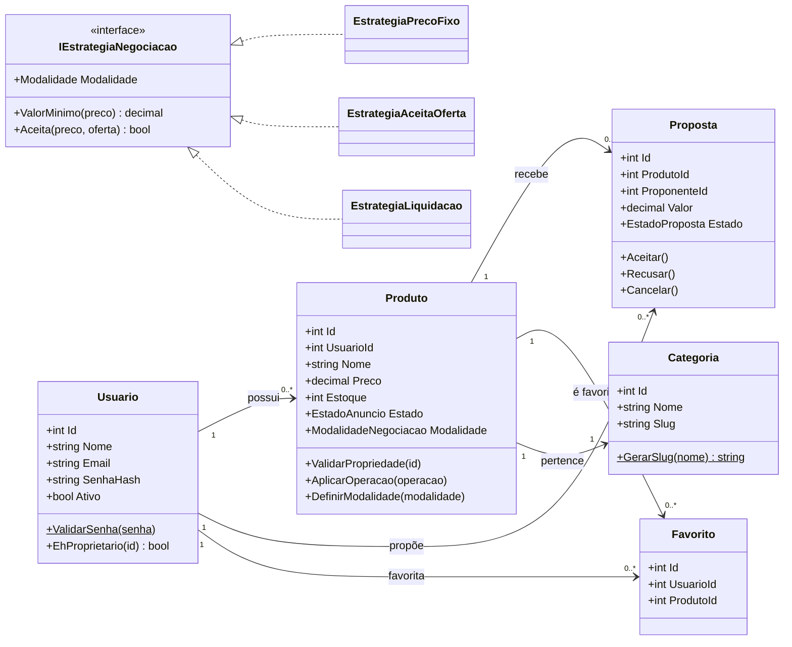
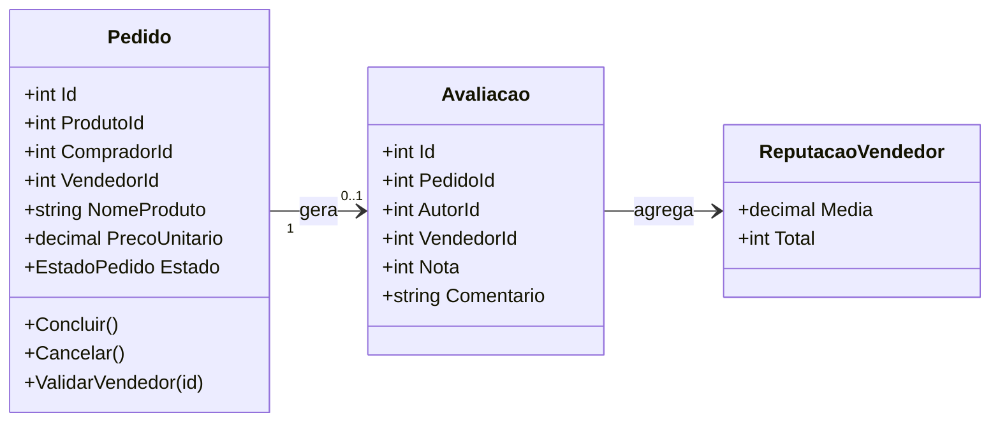
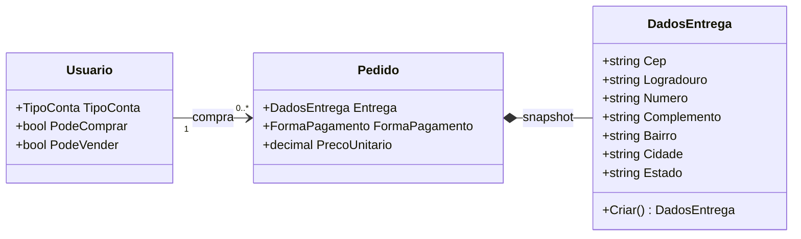

# Modelo de classes — RarityRoom

## 1. Visão geral



## 2. Responsabilidades

### `Usuario`
Representa a conta. Guarda apenas o **hash** da senha, nunca a senha.
Invariantes: nome 3–120 caracteres; e-mail com formato válido e único;
hash no formato `salt:hash`.

### `Produto` (anúncio)
Raiz do agregado de venda. Concentra formação e ciclo de vida.
Invariantes: dono válido; nome ≥ 3; preço > 0; estoque ≥ 0; categoria
existente; imagem, se informada, é URL http(s); transições só pelo par
(origem, operação).

### `Categoria`
Catálogo de categorias. O **slug** é a identidade semântica: normaliza
acentos e caixa, então "Colecionáveis" e "colecionaveis" são a mesma
categoria.

### `Proposta`
Oferta de compra. Invariantes: valor > 0; estados `Pendente`, `Aceita`,
`Recusada`, `Cancelada`; apenas `Pendente` transiciona; somente o proponente
cancela.

### `Favorito`
Vínculo usuário↔anúncio. Invariante: o dono do anúncio não pode favoritá-lo;
não há duplicata por par (usuário, anúncio).

### `IEstrategiaNegociacao`
Contrato de decisão sobre ofertas. Três implementações com regras distintas:

| Implementação | Aceita a partir de | Intenção |
|---|---|---|
| `EstrategiaPrecoFixo` | 100% do preço | não negocia |
| `EstrategiaAceitaOferta` | 85% do preço | negocia com margem |
| `EstrategiaLiquidacao` | 70% do preço | desova estoque |

## 3. Herança

A única relação de especialização é `TransicaoInvalidaException` herdando de
`ConflitoException`: a especialização acrescenta um **código** próprio
(`transicao-invalida`) e permite ao middleware mapear o mesmo status 409 com
identidade distinta. Não há herança usada apenas para reutilizar código.

## 4. Colaboração entre objetos

```
Controller → Serviço → Domínio → Repositório
```

A decisão nunca fica no controller. Exemplo real de colaboração no aceite de
uma proposta:

1. `ServicoPropostas` busca `Proposta` e `Produto`;
2. `Produto.ValidarPropriedade` autoriza;
3. `IEstrategiaNegociacao.Aceita` decide pelo preço e pela modalidade;
4. `Proposta.Aceitar` e `Produto.Reservar` mudam estado;
5. `RecusarDemaisPendentes` fecha as outras ofertas.

## 5. Separação de camadas

| Camada | Responsabilidade | Não faz |
|---|---|---|
| `Controller` | traduzir HTTP ↔ domínio | regra de negócio |
| `Services` | orquestrar e autorizar | formatar resposta |
| `Models` | invariantes e estados | conhecer HTTP |
| `Repositories` | persistir e gerar id | decidir regra |
| `Middleware` | traduzir exceção em ProblemDetails | conhecer regra específica |

## 6. Módulos da compra (Onda 4)



### `Pedido`
Fecha o ciclo de compra. Guarda **snapshot** de `NomeProduto` e `PrecoUnitario`:
editar o anúncio depois não reescreve o histórico. Invariantes: não comprar o
próprio anúncio; anúncio precisa estar `Disponivel`; só o vendedor conclui;
apenas `Pendente` transiciona.

### `Avaliacao`
Nota de 1 a 5 do comprador sobre o vendedor. Invariantes: só existe para pedido
`Concluido`, só o comprador avalia e há no máximo uma por pedido — regra
reforçada por índice único no banco.

### `ReputacaoVendedor`
Valor derivado: média com duas casas e total de avaliações. Vendedor sem
avaliação responde `0 / 0`, nunca erro.

### Upload de imagem
`ServicoImagensArquivo` grava em `wwwroot/uploads` com nome gerado
(`Guid`), validando tamanho (2 MB) e tipo declarado. O nome original enviado
pelo cliente é descartado — o que elimina path traversal e extensão forjada.

## 7. Comprador, vendedor e checkout



### `TipoConta`
Papel escolhido no cadastro: `Comprador`, `Vendedor` ou `Ambos`. Duas derivações
governam o acesso: `PodeComprar` e `PodeVender`. Contas anteriores à mudança
foram migradas como `Ambos`, preservando o que já funcionava.

### `DadosEntrega`
Value object do checkout. `Criar` valida CEP (8 dígitos, formatado como
`00000-000`), logradouro, número, bairro, cidade e UF (duas letras). Fica
gravado no pedido — mudar o cadastro depois não altera compras antigas.

### `FormaPagamento`
`Pix`, `CartaoCredito` ou `Boleto`, validado por `Enum.IsDefined`.

### Regra de papel
`ServicoAnuncios.Criar` exige `PodeVender`; `ServicoPedidos.Criar` exige
`PodeComprar`. A autorização é do domínio, não do controller.
