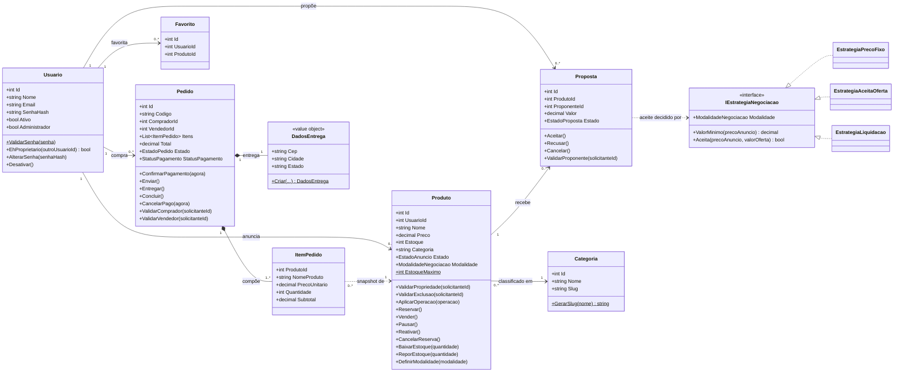

# Modelo de classes — RarityRoom

Modelo textual (Mermaid `classDiagram`, interpretável por ferramentas e pelo
GitHub). Todo atributo e método listado existe com esse nome no código C# de
`backend/Models/`; a §6 confere isso classe a classe.

> Critérios atendidos: **B01** (modelo textual com ≥ 5 classes de domínio),
> **B02/B03** (correspondência com o código, §6), **B04** (associação com
> multiplicidade, §3), **B05** (composição, §4), **B06** (contrato polimórfico,
> §5), **B07** (invariantes e responsáveis, §7).

## 1. Classes selecionadas para avaliação

As cinco classes de domínio centrais são **`Usuario`**, **`Produto`**
(anúncio), **`Proposta`**, **`Pedido`** e **`ItemPedido`**. Completam o modelo
`Categoria`, `Favorito`, o value object `DadosEntrega` e o contrato
`IEstrategiaNegociacao` com suas três implementações.

## 2. Diagrama



## 3. Associações e multiplicidades (B04)

| Associação | Multiplicidade | Implementação no código | Cenário que a testa |
|---|---|---|---|
| `Usuario` anuncia `Produto` | 1 → 0..* | `Produto.UsuarioId` (obrigatório: o construtor rejeita `proprietarioId <= 0`), índice `HasIndex(produto => produto.UsuarioId)` | `Criar_DeveVincularProprietario` |
| `Produto` recebe `Proposta` | 1 → 0..* | `Proposta.ProdutoId`, índice em `RarityRoomContexto` | `Aceitar_DeveRecusarAsDemaisPendentes` (várias propostas, um anúncio) |
| `Usuario` favorita `Produto` | 1 → 0..* (no máximo 1 por par) | índice **único** `(UsuarioId, ProdutoId)` | `ServicoFavoritosTests` (duplicado → 409) |
| `Produto` classificado em `Categoria` | 0..* → 1 | `Produto.Categoria` guarda o nome canônico, validado contra o catálogo em `ServicoAnuncios` | `ServicoAnunciosCategoriaTests` |

**Modelo conceitual × código.** As associações entre agregados são feitas por
**identificador** (`UsuarioId`, `ProdutoId`), sem propriedades de navegação.
Cada agregado é carregado e salvo pelo seu repositório, sem ciclos de objetos.
Multiplicidade não expressa todas as regras: "o dono não propõe no próprio
anúncio" (R4) não cabe no `1 → 0..*` e por isso é protegida por código
(`ServicoPropostas.Criar`), não pelo diagrama.

## 4. Composição e ciclo de vida (B05)

`Pedido *-- ItemPedido` é **composição**, e não apenas associação:

| Evidência | Onde |
|---|---|
| Os itens só nascem dentro do construtor do pedido, que exige pelo menos 1 (`"Não é possível criar um pedido vazio."`) e proíbe repetir anúncio | `Pedido(compradorId, vendedorId, itens, entrega, forma, pagamentoId)` |
| O EF mapeia os itens como **entidade possuída**: sem `DbSet` próprio, gravados e apagados junto com o pedido | `entidade.OwnsMany(pedido => pedido.Itens, ...)` com `WithOwner().HasForeignKey("PedidoId")` em `RarityRoomContexto` |
| O item não muda depois de criado: guarda **snapshot** de nome e preço, independente do anúncio | `ItemPedido.NomeProduto`, `PrecoUnitario`; teste `Snapshot_NaoMudaQuandoOAnuncioMuda` |
| `Total` é derivado dos itens no momento da criação | `Total = lista.Sum(item => item.Subtotal)` |

`Pedido *-- DadosEntrega` também é composição (value object `OwnsOne`, colunas
`Entrega*` na própria tabela `pedidos`). Já `ItemPedido ..> Produto` é só uma
**dependência**: o item copia dados do anúncio, e excluir ou editar o anúncio
não afeta o histórico.

## 5. Contrato polimórfico (B06)

```
IEstrategiaNegociacao
  ├─ EstrategiaPrecoFixo     Aceita se oferta ≥ 100% do preço
  ├─ EstrategiaAceitaOferta  Aceita se oferta ≥ 85% do preço
  └─ EstrategiaLiquidacao    Aceita se oferta ≥ 70% do preço
```

As três classes ficam em `backend/Models/Negociacao/` e são registradas na
injeção de dependência. `ServicoPropostas.Aceitar` escolhe a estratégia pela
`Modalidade` do anúncio e chama apenas `Aceita(...)`, sem `if`/`switch` por
tipo. Teste que comprova o comportamento diferente para a mesma entrada:
`OfertaDe200EmPrecoDe249_90_DeveVariarPorModalidade`.

## 6. Correspondência modelo × código (B02/B03)

Conferido membro a membro com `grep` sobre `backend/Models` em 2026-11-18:

| Classe | Arquivo | Atributos conferidos | Métodos conferidos |
|---|---|---|---|
| `Usuario` | `Models/Usuario.cs` | `Id`, `Nome`, `Email`, `SenhaHash`, `Ativo`, `Administrador` | `ValidarSenha` (static), `EhProprietario`, `AlterarSenha`, `Desativar` |
| `Produto` | `Models/Produto.cs` | `Id`, `UsuarioId`, `Nome`, `Preco`, `Estoque`, `Categoria`, `Estado`, `Modalidade`, `EstoqueMaximo` (const) | `ValidarPropriedade`, `ValidarExclusao`, `AplicarOperacao`, `Reservar`, `Vender`, `Pausar`, `Reativar`, `CancelarReserva`, `BaixarEstoque`, `ReporEstoque`, `DefinirModalidade` |
| `Proposta` | `Models/Proposta.cs` | `Id`, `ProdutoId`, `ProponenteId`, `Valor`, `Estado` | `Aceitar`, `Recusar`, `Cancelar`, `ValidarProponente` |
| `Pedido` | `Models/Pedido.cs` | `Id`, `Codigo`, `CompradorId`, `VendedorId`, `Itens`, `Total`, `Estado`, `StatusPagamento` | `ConfirmarPagamento`, `Enviar`, `Entregar`, `Concluir`, `CancelarPago`, `ValidarComprador`, `ValidarVendedor` |
| `ItemPedido` | `Models/ItemPedido.cs` | `ProdutoId`, `NomeProduto`, `PrecoUnitario`, `Quantidade`, `Subtotal` | — (imutável depois de criado) |

Os atributos de todas as classes têm `set` privado. Toda mutação passa por um
método da própria entidade.

## 7. Invariantes e objeto responsável (B07)

| Invariante | Objeto responsável | Como é protegida | Teste |
|---|---|---|---|
| Estoque sempre entre 0 e `EstoqueMaximo` (100.000) | `Produto` | `EstoqueValido` no construtor e em `Atualizar`; `BaixarEstoque` recusa quantidade acima do disponível; `ReporEstoque` soma em `long` e limita ao teto | `BaixarEstoque_AcimaDoDisponivel_DeveFalharSemAlterar`, `ReporEstoque_NoTeto_NaoEstouraNemFicaNegativo` |
| Estado só muda por par (origem, operação) permitido | `Produto` | dicionário privado `Transicoes`; `AplicarOperacao` lança `TransicaoInvalidaException` antes de alterar qualquer campo | `CancelarReserva_DePausado_DeveFalhar` |
| Anúncio sempre tem dono | `Produto` | construtor rejeita `proprietarioId <= 0`; `UsuarioId` sem setter público | `ProdutoPropriedadeTests` |
| Pedido tem ≥ 1 item, sem anúncio repetido, e comprador ≠ vendedor | `Pedido` | validação no construtor, antes de atribuir os campos | `Construtor_SemItens_DeveFalhar`, `Construtor_NoProprioAnuncio_DeveFalhar` |
| Proposta só transiciona a partir de `Pendente` | `Proposta` | `Aceitar`/`Recusar`/`Cancelar` verificam o estado atual | `Aceitar_PropostaJaAceita_DeveFalhar` |

**Invariante que ultrapassa uma instância:** "ao aceitar uma proposta, nenhuma
outra proposta pendente do mesmo anúncio continua aberta" envolve várias
`Proposta`. Por isso o responsável é `ServicoPropostas`
(`RecusarDemaisPendentes`), que coordena o agregado inteiro na mesma unidade de
trabalho. Teste: `Aceitar_DeveRecusarAsDemaisPendentes`.

## 8. Responsabilidades e camadas

| Camada | Responsabilidade | Não faz |
|---|---|---|
| `Controller` | traduzir HTTP ↔ domínio | regra de negócio |
| `Services` | orquestrar agregados, transação, regras entre instâncias | formatar resposta HTTP |
| `Models` | invariantes, estados e regras de uma instância | conhecer HTTP ou banco |
| `Repositories` | persistir (EF Core + SQLite) | decidir regra |
| `Middleware` | traduzir exceção em ProblemDetails | conhecer regra específica |

**Colaboração no aceite de proposta (FL-02):**

1. `ServicoPropostas` carrega `Proposta` e `Produto`;
2. `Produto.ValidarPropriedade` autoriza o dono (R1);
3. a `IEstrategiaNegociacao` da modalidade decide pelo valor (R3);
4. `Proposta.Aceitar` e `Produto.Reservar` mudam de estado (R2);
5. `RecusarDemaisPendentes` fecha as outras ofertas.

**Herança:** a única especialização de classe é na hierarquia de exceções
(`TransicaoInvalidaException` e `PagamentoRecusadoException`, ambas
`: ConflitoException : ExcecaoDominio`). Cada especialização acrescenta um
código próprio (ex.: `transicao-invalida`) com o mesmo status 409. O
polimorfismo de negócio usa **interface**, não herança.

**Conta única:** `Usuario.TipoConta` continua no modelo de dados por
compatibilidade com contas antigas. Toda conta nova nasce `Ambos`, e nenhum
serviço restringe compra ou venda por esse campo (RC-09).
